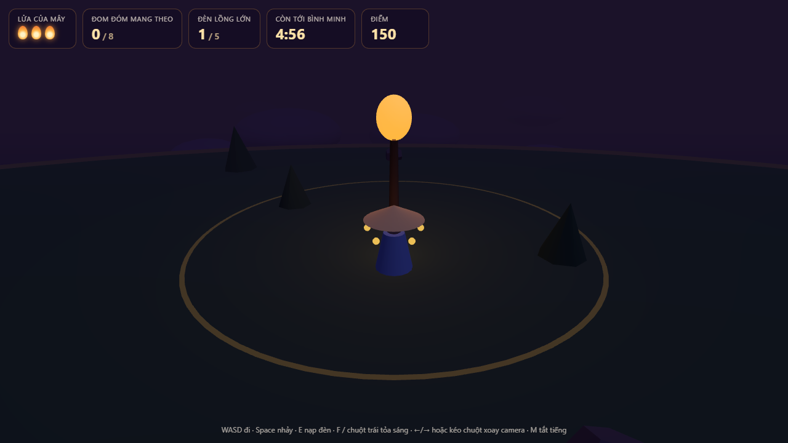

# Đảo Đèn Lồng

> **Video demo:** _sẽ được thêm ở Phase 4 (Release `v1.0.0` / `docs/demo/demo.mp4`)._
> Day 12 · AI SDLC Lab, bài cá nhân. Đề bài gốc của lab: [docs/lab/](docs/lab/LAB_README.md)

Game 3D góc nhìn thứ ba chạy trên trình duyệt (Three.js). Bạn điều khiển **Mây**, người giữ đèn nhỏ tuổi đội nón lá treo đèn lồng, gom **đom đóm** để thắp lại 5 **Đèn Lồng Lớn** của Đảo Bến trước bình minh, và né **Bóng Mực** trong sương đen.



## Cài đặt và chạy (3 lệnh)

Cần **Node.js ≥ 20** (macOS, Linux hoặc Windows).

```bash
git clone https://github.com/khoinguyentran1111/K5-L3A-DAY12-NguyenTranAnhKhoi-2A202603422-AI-SDLC-Dao-Den-Long.git && cd K5-L3A-DAY12-NguyenTranAnhKhoi-2A202603422-AI-SDLC-Dao-Den-Long
npm install
npm start
```

Trình duyệt tự mở `http://localhost:5173` (nếu không tự mở thì mở tay địa chỉ này). Đổi cổng: `PORT=8080 npm start`.

## Điều khiển

| Phím | Hành động |
|---|---|
| `W A S D` / `↑ ↓` | Đi (theo hướng camera) |
| `Space` | Nhảy |
| `E` | Nạp đom đóm vào Đèn Lồng Lớn ở gần |
| `F` / chuột trái | Tỏa sáng: làm choáng và đẩy lùi Bóng Mực ở gần (tốn 2 đom đóm) |
| `←` `→` / kéo chuột | Xoay camera |
| `Enter` / `R` | Bắt đầu / chơi lại sau khi thắng hoặc thua |
| `M` | Tắt/bật âm thanh |

**Luật:** nhặt đom đóm bằng cách đi qua (mang tối đa 8). Mỗi đèn cần 5 đom đóm. Bóng Mực chạm vào thì mất 1 ngọn lửa và rơi một nửa số đom đóm đang mang; hết 3 ngọn lửa là thua. Hết 5 phút (bình minh) mà chưa thắp đủ đèn cũng thua. Bóng Mực không vào được vòng sáng 6 m quanh đèn **đã thắp**.

## Cách tính điểm

| Sự kiện | Điểm |
|---|---|
| Nhặt một đom đóm | +10 |
| Thắp một Đèn Lồng Lớn | +100 |
| Mỗi Bóng Mực bị choáng bởi tỏa sáng | +20 |
| Khi thắng: mỗi giây còn lại (làm tròn xuống) | +1 |
| Khi thắng: mỗi ngọn lửa còn lại | +50 |

## Chế độ headless (Test Contract v1.0)

Khai báo trong [game.contract.json](game.contract.json). Logic chạy 60 tick/giây cố định, không cần cửa sổ hay GPU, tất định theo seed.

```bash
node src/headless.js --seed 42 --night 1 --ticks 3600 --out out/run.jsonl
node src/headless.js --seed 1 --night 1 --scenario scenarios/p1_01_collect_and_light/scenario.json \
     --inputs scenarios/p1_01_collect_and_light/inputs.json --ticks 300 --out out/p1_01.jsonl --snapshot-every 10
```

Mã thoát: `0` thành công · `2` file inputs/scenario thiếu hoặc sai định dạng · `1` tham số dòng lệnh sai (kể cả `--night` khác 1).
Mọi số trong `tuning` là số game đang dùng: `src/core/sim.js` đọc trực tiếp từ file này. Không có trường nào là `null`. `fall_enabled: false`: người chơi bị chặn ở mép đảo, không có sự kiện `fall`.

## Test và kiểm chứng

```bash
npm test                          # 40 test: unit + contract (hộp đen CLI) + scenario + hook
node scripts/scenarios.mjs        # chạy các scenario headless, so với kỳ vọng tính tay
node scripts/mutation-check.mjs   # gài 10 lỗi vào sim, test phải bắt được cả 10
npm run proof -- --phase 1        # sinh lại toàn bộ bằng chứng vào docs/proof/phase1/
```

Bản 3D có chế độ replay chạy đúng file scenario/inputs của headless: `http://localhost:5173/?scenario=p1_05_win_bonus&seed=1`.

## Sáng tạo của tôi

Phần thêm chỉ nằm trong `src/web/` (phía hiển thị), không chạm vào `src/core/sim.js`, nên **output headless không đổi**:
- **Đom đóm bay quanh Mây:** số đom đóm đang mang hiện thành những đốm sáng bay vòng quanh Mây, nên nhìn nhân vật là biết đang mang bao nhiêu.
- **Âm thanh tạo bằng WebAudio:** mỗi lần nhặt đom đóm là một nốt ngũ cung cao dần, có hợp âm khi nạp đèn, chuông khi thắp đèn, và âm riêng khi tỏa sáng, khi bị chạm, khi thắng hoặc thua. Không dùng file âm thanh nào.
- **Gợi ý theo ngữ cảnh** ("Nhấn E để nạp ánh sáng vào L3 (2/5)", "Bóng Mực ở gần! Nhấn F…") và chấm tiến độ nạp đèn quanh chân mỗi Đèn Lồng Lớn.

Bằng chứng phần lõi vẫn đúng: toàn bộ test, scenario và kiểm tra tất định đều chạy trên `src/core` ([docs/proof/phase1.md](docs/proof/phase1.md)); `src/core` không import gì từ `src/web`.

## Tài liệu

| | |
|---|---|
| Yêu cầu gốc từng phase | [docs/requirements/](docs/requirements/) |
| Giả định, tiêu chí nghiệm thu, đánh giá | [docs/notes/phase1.md](docs/notes/phase1.md) |
| Bảng truy vết bằng chứng | [docs/proof/phase1.md](docs/proof/phase1.md) |
| Nhật ký dùng AI và token | [docs/notes/ai_log.md](docs/notes/ai_log.md) |
| Harness AI | [AGENTS.md](AGENTS.md), [CLAUDE.md](CLAUDE.md), [.claude/](.claude/) (skills, hooks, agent reviewer), [CI](.github/workflows/ci.yml) |
| Nguồn và giấy phép | [CREDITS.md](CREDITS.md), [LICENSE](LICENSE) |

## Cấu trúc

```text
src/core/      luật game thuần + tất định (sim.js), validate (io.js), RNG
src/headless.js  CLI theo Test Contract
src/web/       client Three.js (chỉ hiển thị + input), âm thanh
scenarios/     scenario headless + expect.json (kỳ vọng tính tay)
tests/         node:test, gồm unit, contract, scenario, hook
scripts/       serve, scenarios, proof, mutation-check, hooks/
docs/          requirements/, notes/, proof/, lab/
```
