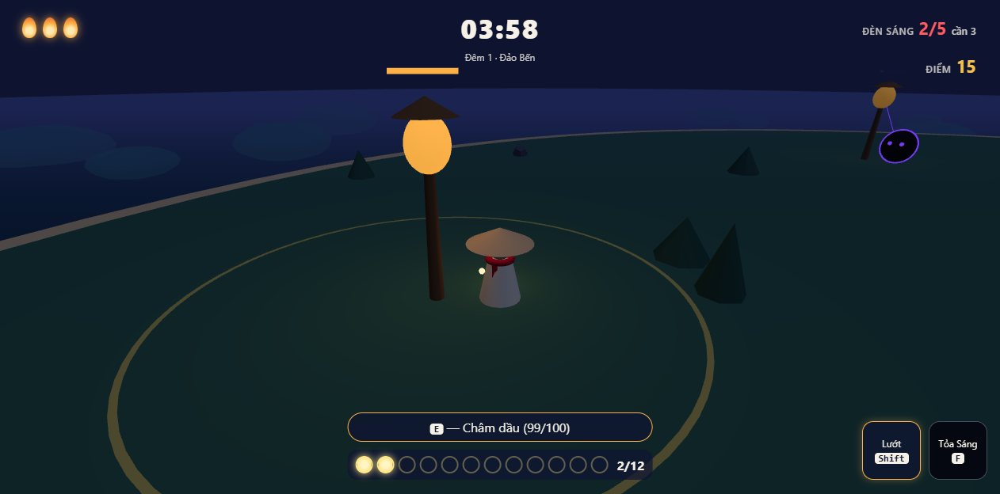

# Đảo Đèn Lồng

> **Video demo (4:14):** [demo.mp4](https://github.com/khoinguyentran1111/K5-L3A-DAY12-NguyenTranAnhKhoi-2A202603422-AI-SDLC-Dao-Den-Long/releases/download/v1.0.0/demo.mp4) · **Bản phát hành:** [Release v1.0.0](https://github.com/khoinguyentran1111/K5-L3A-DAY12-NguyenTranAnhKhoi-2A202603422-AI-SDLC-Dao-Den-Long/releases/tag/v1.0.0) (gói chạy được + video demo).
> Day 12 · AI SDLC Lab, bài cá nhân. Đề bài gốc của lab: [docs/lab/](docs/lab/LAB_README.md)

Game 3D góc nhìn thứ ba chạy trên trình duyệt (Three.js). Bạn điều khiển **Mây**, người giữ đèn nhỏ tuổi đội nón lá, quàng khăn đỏ, treo đèn lồng. Mây gom **đom đóm** để thắp các **Đèn Lồng Lớn** trên **ba hòn đảo** (Đảo Bến, Đảo Cau, Đảo Chuông) và **giữ cho đảo còn sáng tới bình minh**: đèn cạn dầu sẽ tắt, **Bóng Mực** rình hút dầu, **Gió Lạc** cướp đom đóm.



## Yêu cầu hệ thống

- **Node.js ≥ 20** (macOS, Linux hoặc Windows); trình duyệt có WebGL 2 (Chrome, Edge, Firefox, Safari bản mới).
- Benchmark (`bench_cmd`): thêm **Chrome hoặc Edge** và Node ≥ 22. Card đồ họa tích hợp là đủ (máy làm bài: Intel UHD, 148 FPS).

## Cài đặt và chạy (3 lệnh)

```bash
git clone https://github.com/khoinguyentran1111/K5-L3A-DAY12-NguyenTranAnhKhoi-2A202603422-AI-SDLC-Dao-Den-Long.git && cd K5-L3A-DAY12-NguyenTranAnhKhoi-2A202603422-AI-SDLC-Dao-Den-Long
npm install
npm start
```

Trình duyệt tự mở `http://localhost:5173` (nếu không tự mở thì mở tay địa chỉ này). Đổi cổng: `PORT=8080 npm start`. Vào thẳng một Đêm: `http://localhost:5173/?autostart&night=3`.

## Điều khiển

| Phím | Hành động |
|---|---|
| `W A S D` | Đi (theo hướng camera) |
| `Space` | Nhảy |
| `Shift` | Lướt (14 m/s trong 0.2 s, hồi 1.5 s) |
| `E` | Nạp đom đóm vào Đèn Lồng Lớn ở gần: thắp (10, thắp lại 5) hoặc châm dầu |
| `F` / chuột trái | Tỏa Sáng: làm choáng và đẩy lùi Bóng Mực trong 5 m (tốn 3 đom đóm, hồi 3 s) |
| `←` `→` / kéo chuột | Xoay camera (độ nhạy chỉnh trong Cài đặt) |
| `Esc` | Tạm dừng: Tiếp tục · Chơi lại Đêm · Cài đặt · Về menu |
| `Enter` | Chọn nút chính trên các màn hình |

Mọi phím (4 hướng, nhảy, lướt, tương tác, tỏa sáng, tạm dừng) **đổi được trong Cài đặt**; game báo khi trùng phím và có nút "Khôi phục mặc định".

**Dễ tiếp cận (Cài đặt, được lưu):**
- Phụ đề và chỉ báo hình ảnh cho: Bóng Mực xuất hiện (kèm mũi tên ở mép màn hình), gió sắp thổi, 10 giây cuối, đèn dưới 30 dầu.
- Giảm chuyển động: tắt rung camera và chớp màn hình.
- Chữ tối thiểu 18 px ở 1280×720, có tùy chọn chữ lớn ×1.25.
- Bảng màu dễ phân biệt.

**Bảng xếp hạng:** sau màn Bình Minh hoặc khi thua, nhập tên (3–12 ký tự, có dấu tiếng Việt cũng được) để lưu điểm. Top 10 được lưu trên đĩa ở `data/leaderboard.json`. Xem trong menu "Bảng xếp hạng". Xuất ra file: `node scripts/serve.mjs --export-leaderboard out.json` (`run_cmd` của contract là `node scripts/serve.mjs`).

**Luật chính (Ticket-03):** mỗi đèn cần 10 đom đóm để thắp lần đầu, 5 để thắp lại. Đèn sáng có **dầu 0–100**, hao 1/giây; đứng cạnh nhấn `E` để châm (mỗi đom đóm +10 dầu). Hết dầu thì đèn tắt. Đèn dưới 30 dầu nhấp nháy và **mất vòng an toàn 6 m**: Bóng Mực sẽ kéo tới và **hút dầu** (5/giây mỗi con, có tia nối tới đèn); tỏa sáng để đuổi chúng. Sức chứa bắt đầu 10, +2 mỗi lần thắp, tối đa 20. Bóng Mực chạm vào thì mất 1 Ngọn Lửa (có 3) và rơi một nửa số đom đóm đang mang; rơi khỏi đảo cũng mất 1 Ngọn Lửa. Gió Lạc (Đêm 2, 3) cướp đom đóm khi bạn mang từ 5 con trở lên. Bùa Gió đỏ giúp chạy 7.2 m/s và lướt liên tục trong 10 giây. **Thắng một Đêm** khi còn sống lúc bình minh (240 / 270 / 300 s) và số đèn đang sáng ≥ 3/5, 4/6, 5/7. Thắp hết đèn sớm không kết thúc Đêm.

## Cách tính điểm (chuẩn Ticket-03)

| Sự kiện | Điểm |
|---|---|
| Mỗi đom đóm nạp vào đèn (thắp, thắp lại hoặc châm dầu) | +5 |
| Thắp một đèn lần đầu | +100 |
| Thắp lại một đèn đã tắt | +40 |
| Tỏa Sáng trúng Bóng Mực (mỗi con) | +5, hoặc +15 nếu nó đang hút dầu |
| Bình minh (chỉ khi thắng): mỗi đèn đang sáng | +50 + floor(dầu) |
| Bình minh (chỉ khi thắng): mỗi Ngọn Lửa còn lại | +50 |

Tổng điểm của cả chuỗi là tổng điểm các Đêm đã thắng.

## Chế độ headless (Test Contract v1.3)

Khai báo trong [game.contract.json](game.contract.json). Logic chạy 60 tick/giây cố định, không cần cửa sổ hay GPU, tất định theo seed. Một Đêm đầy đủ (tới bình minh) chạy dưới 0.3 giây. v1.2 thêm `fuel`/`ever_lit`/`relit_count` cho đèn, `capacity` cho người chơi, trạng thái `drain`, sự kiện `refuel`/`lantern_out`/`fuel_drain` (danh sách đầy đủ trong [CHANGELOG.md](CHANGELOG.md)).

```bash
node src/headless.js --seed 42 --night 2 --ticks 3600 --out out/run.jsonl
node src/headless.js --seed 1 --night 1 --scenario scenarios/p3_05_drain_until_out/scenario.json --ticks 300 --out out/drain.jsonl
```

Mã thoát: `0` thành công · `2` file inputs/scenario thiếu, sai định dạng hoặc không hợp với Đêm (ví dụ đèn `L7` ở Đêm 1) · `1` tham số dòng lệnh sai (kể cả `--night` ngoài 1–3).
Mọi số trong `tuning` là số chuẩn mà game đang dùng (`src/core/sim.js` đọc trực tiếp từ file); không có trường nào là `null`. Giả định cho những chỗ ticket còn mơ hồ: [Phase 2](docs/notes/phase2.md) (B1–B25), [Phase 3](docs/notes/phase3.md) (C1–C19). Quyết định thiết kế mô hình dầu và luật thắng: [ADR 0001](docs/adr/0001-lantern-fuel-and-dawn-win.md).

## Benchmark và soak test (Ticket-04)

```bash
node scripts/bench.mjs --seed 42 --duration 30 --out bench.json   # bench_cmd
node scripts/soak.mjs  --seed 7  --nights 10   --out soak.json    # soak_cmd
```

- **Benchmark:** mở một cửa sổ Chrome/Edge thật (chế độ app, không toàn màn hình), vùng trang đúng 1280×720 (tỉ lệ điểm ảnh 1). **Vsync được tắt** bằng `--disable-gpu-vsync --disable-frame-rate-limit`. Cảnh chuẩn: Đêm 1 với đầy đủ ánh sáng, 200 Bóng Mực `wander`, 100 đom đóm, L1–L3 sáng. Camera bay vòng r = 30 m ở Y = 15 m, ngược chiều kim đồng hồ, 15 s/vòng. Khởi động 3 s rồi đo 30 s.
  - `load_ms`: tính từ lúc tiến trình bench bắt đầu tới khung hình đầu tiên.
  - `peak_mem_mb`: tổng RSS đỉnh của mọi tiến trình trình duyệt trong lần chạy. Game web chạy trong các tiến trình đó, nên số này lấy từ bộ đếm của hệ điều hành, đọc một lần sau khi đo xong để không làm nhiễu FPS.
  - Thêm `--headless` nếu máy không có màn hình.
  - Kết quả trên máy làm bài: [bench.json](bench.json) (148.6 FPS trung bình, 1% low 52 FPS, load 1.3 s).
- **Soak:** 10 Đêm liên tiếp trong một tiến trình (1 → 2 → 3 xoay vòng, seed 7 + i, input ngẫu nhiên theo seed). Kết quả: [soak.json](soak.json) (0 crash, RSS 39.7 → 43.1 MB).
  - Script tự chạy lại chính nó với `--expose-gc --max-semi-space-size=1 --no-opt`. Lý do: RSS đầu được đo ngay sau khi tải Đêm 1, nên phần V8 biên dịch JIT và nới heap người trẻ (một lần, khoảng 6–10 MB) không bị tính như rò rỉ.
  - Chạy không cờ: `DDL_SOAK_PLAIN=1`. Khi đó RSS cũng đứng yên khoảng 48 MB từ Đêm 2 tới Đêm 30, tức là không rò rỉ, nhưng tỉ lệ so với lúc mới tải vượt 1.2×.

## Test và kiểm chứng

```bash
npm test                          # unit + contract (hộp đen CLI) + 44 scenario + hook + bảng màu
node scripts/scenarios.mjs        # chạy các scenario headless, so với kỳ vọng tính tay
node scripts/mutation-check.mjs   # gài 40 lỗi vào sim (trên bản sao tạm), test phải bắt được cả 40
node scripts/browser-check.mjs    # bản 3D trên Chrome/Edge headless: menu → Đêm → kết quả, tạm dừng, cài đặt, HUD
npm run proof -- --phase 4 --gpu  # sinh lại toàn bộ bằng chứng (kèm FPS bằng GPU) vào docs/proof/phase4/
npm run package                   # gói phát hành dist/dao-den-long-v1.0.0.zip (chạy được không cần npm install)
```

Bản 3D có chế độ replay chạy đúng file scenario/inputs của headless, ví dụ `http://localhost:5173/?scenario=p3_05_drain_until_out` (thêm `&live` để dựng scenario rồi tự điều khiển).

**Cài đặt trong game:** âm lượng, độ nhạy chuột, **Bảng màu dễ phân biệt** (Bóng Mực viền xanh #00B3FF, cảnh báo trắng kèm ⚠; đèn tắt thì xẹp và rách giấy, đèn sắp cạn nhấp nháy, nên phân biệt được không cần màu). Tất cả được lưu lại.

## Sáng tạo của tôi

Phần thêm chỉ nằm trong `src/web/` (phía hiển thị), không chạm vào `src/core/`, nên **output headless không đổi**:
- **Ông Đăng**, người giữ đèn già: mỗi Đêm mở đầu bằng lời dặn riêng (kèm mẹo cho cơ chế mới của Đêm đó), có lời động viên khi thua và lời chúc ở màn Bình Minh.
- **Đom đóm bay quanh Mây:** số đom đóm đang mang hiện thành những đốm sáng bay vòng quanh Mây.
- **Âm thanh tự sinh bằng WebAudio:** nhạc nền đêm (hợp âm nền và chuông ngũ cung ngẫu nhiên); nốt nhặt đom đóm cao dần theo số đang mang; chuông thắp đèn; tiếng gió báo trước cơn gió. Không dùng file âm thanh nào.
- **Camera tránh tháp chuông:** camera tự kéo lại gần khi tháp che mất Mây.
- Gợi ý theo ngữ cảnh, chấm tiến độ nạp quanh chân mỗi đèn, đom đóm rơi nhấp nháy khi sắp tan.

Bằng chứng phần lõi vẫn đúng: toàn bộ test, scenario và kiểm tra tất định đều chạy trên `src/core` ([docs/proof/phase2.md](docs/proof/phase2.md)); `src/core` không import gì từ `src/web`.

## Tài liệu

| | |
|---|---|
| Yêu cầu gốc từng phase | [docs/requirements/](docs/requirements/) |
| Spec, giả định, đánh giá | [Phase 1](docs/notes/phase1.md) · [Phase 2](docs/notes/phase2.md) · [Phase 3](docs/notes/phase3.md) · [Phase 4](docs/notes/phase4.md) · [Retro](docs/notes/retro.md) |
| Quyết định thiết kế (ADR) · Thay đổi phá vỡ tương thích | [docs/adr/](docs/adr/) · [CHANGELOG.md](CHANGELOG.md) |
| Bảng truy vết bằng chứng | [Phase 1](docs/proof/phase1.md) · [Phase 2](docs/proof/phase2.md) · [Phase 3](docs/proof/phase3.md) · [Phase 4](docs/proof/phase4.md) |
| Nhật ký dùng AI và token | [docs/notes/ai_log.md](docs/notes/ai_log.md) |
| Harness AI | [AGENTS.md](AGENTS.md), [CLAUDE.md](CLAUDE.md), [.claude/](.claude/) (skills, hooks, agent reviewer), [CI](.github/workflows/ci.yml) |
| Nguồn và giấy phép | [CREDITS.md](CREDITS.md), [LICENSE](LICENSE) |

## Cấu trúc

```text
src/core/        luật thuần + tất định: sim.js (12 bước/tick, dầu đèn, drain), maps.js (3 bản đồ), io.js, rng.js
src/headless.js  CLI theo Test Contract v1.3
src/web/         client Three.js: main.js (chuỗi Đêm, HUD), world.js, palette.js, audio.js, settings.js
scenarios/       p3_*, p2_* (đang dùng) · obsolete-v1.0/, obsolete-v1.1/ (bị ticket sau thay, có lý do) · ui_* (chỉ cho giao diện)
tests/           node:test: unit, contract, scenario, hook, bảng màu
scripts/         serve (+ bảng xếp hạng), bench, soak, package, scenarios, proof, mutation-check, browser-check, hooks/
docs/            requirements/, notes/, adr/, proof/, lab/
```
